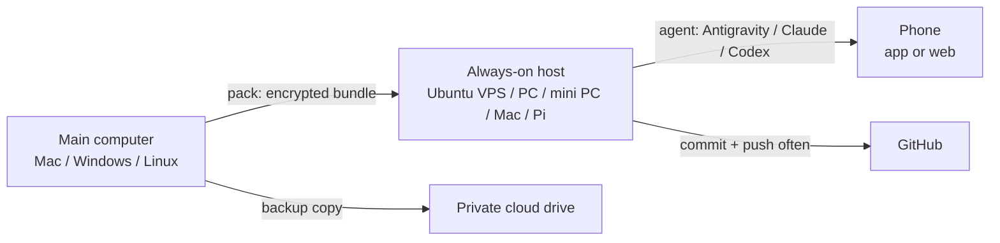

# vibecode-anywhere

**Keep coding from anywhere with just your phone.** An always-on machine (VPS, workstation, mini PC, Mac mini, plugged-in laptop or Raspberry Pi, running **Linux, macOS or Windows**) runs your coding agent (**Antigravity CLI**, **Claude Code**, **OpenAI Codex**), and you drive it from your phone. This kit moves your whole working state from your main computer to that machine: repos on the right branch, uncommitted work, `.env` files, agent config. It also gives the agent a rulebook for staying safe when its owner only has a phone.

[Tiếng Việt](README.md) · [Choose & set up a host](docs/HOSTS.en.md) · [Agent guide](docs/AGENTS-GUIDE.md) · [Rescue sheet](docs/RESCUE.en.md) · [AI prompt](PROMPT.md) · [Changelog](CHANGELOG.md)

> Author: **Nguyễn Việt Thành (Tsen)**, [github.com/tsennguyen](https://github.com/tsennguyen). I built this for a 3-day trip with urgent work and nothing but a phone. MIT licensed: use it, change it, share it, just keep the credit line.



## What's inside
| File | Runs on | Does |
|---|---|---|
| `PROMPT.md` | any AI | **Start here if you don't want to read.** Paste it into your agent; it interviews you and fills in the config |
| `config/hub.example.conf` | | Config template: host kind, repos, secrets to carry, agents, stacks. Copy to `config/hub.conf` |
| `profiles/*.conf` | | `small` (≤4 GB), `medium` (~8 GB), `large` (≥16 GB): swap, RAM limits, Playwright, Docker advice |
| `pack.sh` | main computer | Snapshot every repo + gitignored files → **one encrypted file** `~/vibecode-out/bundle.tar.gz.enc` |
| `bootstrap.sh` | Linux / macOS host, once | Installs only what the config selects (apt or Homebrew), keeps the machine awake, enables SSH on home machines |
| `bootstrap.ps1` | Windows host, once (asks for UAC) | Same with winget; blocks surprise Windows Update reboots; enables OpenSSH Server |
| `vibe.ps1` | Windows | Run any script from PowerShell: `.\vibe.ps1 pack`, `sync`, `install-deps`, `remote`, `doctor`, `save-all` |
| `sync.sh` | host | Clones repos, restores branch + commit, re-applies uncommitted work, puts secrets back, renders agent rules. `--clone-only` when you have no bundle |
| `install-deps.sh` | host | Detects lockfiles (npm/pnpm/yarn/bun/uv/pip/Maven/Gradle/Go/Cargo), installs, runs smoke tests |
| `remote.sh` | host | `login` / `start` / `status` / `autostart` phone remote control for each agent, per OS |
| `doctor.sh` | host | Read-only health check (agents, RAM, disk, network, SSH, unpushed work) |
| `save-all.sh` | host | Commit + push all pending work, never force; protected branches move to `wip/rescue-…` |
| `templates/AGENTS.md.tpl` | | Agent rules, filled from config and machine kind, placed in `~/.gemini/GEMINI.md`, `~/.claude/CLAUDE.md`, `~/.codex/AGENTS.md` |

## Pick your setup
**Host:** details, pros and cons, and a home-machine checklist are in [docs/HOSTS.en.md](docs/HOSTS.en.md).

| `HOST_KIND` | OS | When |
|---|---|---|
| `vps` | Ubuntu 22.04 / 24.04 | Long trips, must not fail. The author uses 6 vCPU / 8 GB / 50 GB |
| `workstation`, `minipc`, `laptop` | Linux, Windows, macOS | A machine you already have at home; add Tailscale for SSH, no open ports |
| `mac` | macOS | Mac mini: power-efficient; official Codex path through the ChatGPT app |
| `sbc` | Raspberry Pi OS 64-bit | Cheapest; `PROFILE="small"` |

**RAM** (`PROFILE`): `small` ≤4 GB (edit only, builds on CI) · `medium` ~8 GB · `large` ≥16 GB · `auto` to let the kit choose.

**Main computer** (where you pack): macOS, Linux, Windows ([Git for Windows](https://git-scm.com/download/win) required).

**Agents.** Pick one primary agent, plus a backup if you can:

| | Antigravity | Claude Code | Codex |
|---|---|---|---|
| On the phone | antigravity.google.com | Claude app → Code | ChatGPT app → Codex |
| Account | Google | Pro/Max/Team/Enterprise (API keys do **not** work for remote control) | ChatGPT |
| Linux host | service, comes back after reboot | tmux (+ `autostart`) | via a ChatGPT app on another machine, or SSH + tmux |
| macOS / Windows host | service; needs automatic login | tmux / background window (+ `autostart`) | **ChatGPT desktop app: official** |

Details and sources: [docs/AGENTS-GUIDE.md](docs/AGENTS-GUIDE.md).

---

## How to use
### 1. On your main computer: configure + pack (~10 min)
```bash
git clone https://github.com/tsennguyen/vibecode-anywhere && cd vibecode-anywhere
cp config/hub.example.conf config/hub.conf     # edit it, OR paste PROMPT.md into your agent
./pack.sh                                      # Windows: .\vibe.ps1 pack
```
- Output: `~/vibecode-out/` holds `bundle.tar.gz.enc` (encrypted) and `hub.conf` (no secrets).
- The **passphrase** is in `~/.vibecode-pass`. Save it in your phone's password manager, **not** next to the bundle.
- Upload `vibecode-out` to a private cloud drive as a backup.
- Nothing to carry besides code on GitHub? Skip this step and run `sync --clone-only` on the host.

### 2. Set up the host (~40 min)
Copy the bundle to the host (if you're sitting at the host, a USB stick or a cloud drive works too):
```bash
ssh-keygen -t ed25519 -f ~/.ssh/vibecode && ssh-copy-id -i ~/.ssh/vibecode.pub -p PORT USER@HOST
scp -i ~/.ssh/vibecode -P PORT -r ~/vibecode-out USER@HOST:~/
```
Windows has no `ssh-copy-id`: in PowerShell, run `type $env:USERPROFILE\.ssh\vibecode.pub | ssh -p PORT USER@HOST "mkdir -p ~/.ssh && cat >> ~/.ssh/authorized_keys"`. `scp` ships with Windows 10/11.

**Linux / macOS host:**
```bash
git clone https://github.com/tsennguyen/vibecode-anywhere ~/vibecode-anywhere && cd ~/vibecode-anywhere
./bootstrap.sh                 # finds the config in ~/vibecode-out/hub.conf
# open a new terminal / SSH session, then:
gh auth login --web --git-protocol https && gh auth setup-git
./sync.sh && ./install-deps.sh
./remote.sh login && ./remote.sh start && ./doctor.sh
```
**Windows host:** use a **normal** PowerShell (not "Run as administrator"), signed in as the account the agents will run under:
```powershell
winget install --id Git.Git -e          # then open a new PowerShell window
git clone https://github.com/tsennguyen/vibecode-anywhere $HOME\vibecode-anywhere; cd $HOME\vibecode-anywhere
powershell -ExecutionPolicy Bypass -File .\bootstrap.ps1   # asks for admin (UAC) once for the system part
```
Then open a new PowerShell:
```powershell
gh auth login --web --git-protocol https; gh auth setup-git
.\vibe.ps1 sync; .\vibe.ps1 install-deps
.\vibe.ps1 remote login; .\vibe.ps1 remote start; .\vibe.ps1 doctor
```
Home machines (workstation, mini PC, Mac, laptop) also need the [checklist in HOSTS.en.md](docs/HOSTS.en.md#4-checklist-for-home-machines-workstation-mini-pc-laptop-mac-pi): BIOS power-on after outage, automatic login, `remote autostart claude`, Tailscale. Then pull the plug once to test.

### 3. On your phone
- Open each agent's app/site (table above), sign in with the same account, pick the `HOST_NAME` machine, and use **Add to Home Screen**.
- Antigravity: **pick a project** every time you start a new chat.
- Install **Termius** (or Blink / JuiceSSH), save the host (through Tailscale for a home machine), and test SSH once. Save [docs/RESCUE.en.md](docs/RESCUE.en.md) for offline reading.
- Paste **Prompt 2** from [PROMPT.md](PROMPT.md) to test read, write and push.

### 4. While travelling
- The agent's rules tell it to **commit + push after every change and every test run**, keep off protected branches, never reboot, never touch power or network settings, never print secrets, and run one heavy job at a time. On a shared machine (`HOST_SHARED=1`) it also stays away from other people's apps and files.
- To see UI: use the **preview deployment** link (Vercel/Netlify/Cloudflare) of the pushed branch, or a Playwright screenshot.
- When something breaks: SSH in, run `doctor.sh` (Windows: `.\vibe.ps1 doctor`), and follow the [rescue sheet](docs/RESCUE.en.md).

### 5. Back home
Run `save-all.sh` on the host, then `git fetch` and check out the pushed branches on your main computer. To bring uncommitted work home as well, run `pack.sh` on the host and copy the bundle back.

## Customize
- **Your own agent rules:** write them in `config/rules.extra.md`; the next `sync.sh` appends them to the rules. To change the shared rules, edit `templates/AGENTS.md.tpl`.
- **Same absolute paths as your main computer** (Linux/macOS hosts): set `MIRROR_PATH="/Users/you/code"`.
- **Public repos:** list them in `PUBLIC_REPOS`. `.git/info/exclude` and local git hooks travel in the bundle.
- **Custom install for one repo:** `DEP_COMMANDS=("my-app|pnpm install && pnpm exec lefthook install")`.
- **New profile:** copy `profiles/medium.conf` to a new name and set `PROFILE="new-name"`.
- **See the resolved config:** `./scripts/print-config.sh` (Windows: `.\vibe.ps1 config`).

## Security
- `config/hub.conf` holds no secrets and is gitignored. Secrets live only in the encrypted bundle (AES-256-CBC, PBKDF2 200k iterations, SHA-256; LibreSSL and OpenSSL 3 can read each other's bundles).
- `pack.sh` **always skips** login token files (`auth.json`, `.credentials.json`, `oauth*`, `*token*`, SSH keys). Sign in again on the host.
- `save-all.sh` **never commits** new files that look like secrets (`.env*`, keys, credentials…) or are listed in `EXTRAS`; in `PUBLIC_REPOS` it never commits AI files either (`AGENTS.md`, `CLAUDE.md`, `.claude/`…). `sync.sh` backs up every file it would overwrite to `~/.vibecode-backup/`.
- Anyone with a remote-control session link can drive that session. Turn on 2FA for your Google / Claude / ChatGPT accounts.
- Home machines: use SSH keys over Tailscale, with **no port forwarding** on your router. Automatic login means anyone with physical access gets your session, so keep the machine somewhere safe.

## Contributing
Issues and PRs are welcome: more distros, agents, profiles, translations. Keep `pack.sh` and `scripts/lib.sh` compatible with bash 3.2 (macOS) and Git Bash (Windows). Save `.ps1` files as UTF-8 with BOM.

## Credit
Idea, design and first version by **Nguyễn Việt Thành (Tsen)**, 2026. Released under the [MIT License](LICENSE).
