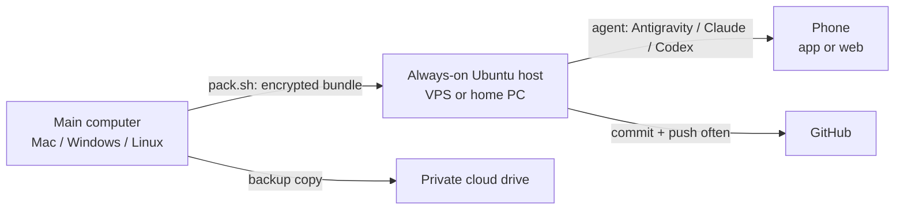

# vibecode-anywhere

**Keep coding from anywhere with just your phone.** An always-on Ubuntu machine (rented VPS or a PC at home) runs your coding agent (**Antigravity CLI**, **Claude Code**, **OpenAI Codex**), and you drive it from your phone. This kit moves your whole working state from your main computer to that machine: repos on the right branch, uncommitted work, `.env` files, agent config. It also gives the agent a rulebook for staying safe when its owner only has a phone.

[Tiếng Việt](README.md) · [Agent guide](docs/AGENTS-GUIDE.md) · [Rescue sheet](docs/RESCUE.en.md) · [AI prompt](PROMPT.md)

> Author: **Nguyễn Việt Thành (Tsen)**, [github.com/tsennguyen](https://github.com/tsennguyen). I built this for a 3-day trip with urgent work and nothing but a phone. MIT licensed: use it, change it, share it, just keep the credit line.



## What's inside
| File | Runs on | Does |
|---|---|---|
| `PROMPT.md` | any AI | **Start here if you don't want to read.** Paste it into your agent; it interviews you and fills in the config |
| `config/hub.example.conf` | | Config template: repos, secrets to carry, agents, stacks, machine size. Copy to `config/hub.conf` |
| `profiles/*.conf` | | `small` (≤4 GB), `medium` (~8 GB), `large` (≥16 GB): swap, RAM limits, Playwright, Docker advice |
| `pack.sh` / `pack.ps1` | main computer (Mac, Linux / Windows) | Snapshot every repo + gitignored files → **one encrypted file** `~/vibecode-out/bundle.tar.gz.enc` |
| `bootstrap.sh` | host, once | Installs only what the config selects: swap, Node/pnpm/uv/Java/Docker/Go/Rust, gh/vercel/supabase/tailscale, agents; keeps the machine awake |
| `sync.sh` | host | Clones repos, restores branch + commit, re-applies uncommitted work, puts secrets back, renders agent rules. Safe to re-run. `--clone-only` when you have no bundle |
| `install-deps.sh` | host | Detects lockfiles (npm/pnpm/yarn/bun/uv/pip/Maven/Gradle/Go/Cargo), installs, runs smoke tests |
| `remote.sh` | host | `login` / `start` / `status` phone remote control for each agent |
| `doctor.sh` | host | Read-only health check (agents, RAM, disk, network, unpushed work) |
| `save-all.sh` | host | Commit + push all pending work, never force; protected branches move to `wip/rescue-…` |
| `templates/AGENTS.md.tpl` | | Agent rules, filled from config, linked into `~/.gemini/GEMINI.md`, `~/.claude/CLAUDE.md`, `~/.codex/AGENTS.md` |
| `docs/RESCUE.en.md` | phone | Fix-it sheet by symptom (section numbers match `doctor.sh`) |

## Pick your setup
**Host (where the agent runs).** The scripts support Ubuntu 22.04+ and Debian 12+, on amd64 or arm64.

| Need | Suggested machine | `PROFILE` | Notes |
|---|---|---|---|
| Edit code, light tests; heavy builds on CI | VPS 2 vCPU / 4 GB | `small` | Cheapest. No Playwright, one container at a time |
| Full-stack web, Docker, e2e | VPS 4–6 vCPU / 8 GB | `medium` | The author's setup (6 vCPU / 8 GB / 50 GB). One heavy job at a time |
| Big monorepo, many services | Home PC or VPS ≥16 GB | `large` | Home PC behind a router: add `tailscale` for SSH, no open ports |
| Only an always-on Windows PC | WSL2 + Ubuntu | by RAM | Experimental, see the [agent guide](docs/AGENTS-GUIDE.md#windows--wsl2-as-the-host-experimental) |

**Main computer (where you pack):** macOS, Linux, or Windows ([Git for Windows](https://git-scm.com/download/win) required; run `pack.ps1`, or `pack.sh` in Git Bash).

**Agents.** Pick one primary agent, plus a backup if you can:

| | Antigravity | Claude Code | Codex |
|---|---|---|---|
| On the phone | antigravity.google.com | Claude app → Code | ChatGPT app → Codex |
| Account | Google | Pro/Max/Team/Enterprise (API keys do **not** work for remote control) | ChatGPT |
| Runs in the background on the host | official service, comes back after reboot | in tmux (`remote.sh start claude`) | needs the ChatGPT desktop app (Mac/Win) opening the host over SSH; otherwise SSH + tmux |

Details and sources: [docs/AGENTS-GUIDE.md](docs/AGENTS-GUIDE.md).

---

## How to use
### 1. On your main computer: configure + pack (~10 min)
```bash
git clone https://github.com/tsennguyen/vibecode-anywhere && cd vibecode-anywhere
cp config/hub.example.conf config/hub.conf     # edit it, OR paste PROMPT.md into your agent
./pack.sh                                      # Windows: powershell -ExecutionPolicy Bypass -File .\pack.ps1
```
- Output: `~/vibecode-out/` holds `bundle.tar.gz.enc` (encrypted) and `hub.conf` (no secrets).
- The **passphrase** is in `~/.vibecode-pass`. Save it in your phone's password manager, **not** next to the bundle.
- Upload `vibecode-out` to a private cloud drive as a backup, so you can rebuild even if the host is wiped.
- Nothing to carry besides code on GitHub? Skip `pack.sh` and run `./sync.sh --clone-only` on the host.

### 2. Set up the host (~40 min)
```bash
# on the main computer: install an SSH key (you type the host password once)
ssh-keygen -t ed25519 -f ~/.ssh/vibecode && ssh-copy-id -i ~/.ssh/vibecode.pub -p PORT USER@HOST
scp -i ~/.ssh/vibecode -P PORT -r ~/vibecode-out USER@HOST:~/
```
Windows has no `ssh-copy-id`: in PowerShell run `type $env:USERPROFILE\.ssh\vibecode.pub | ssh -p PORT USER@HOST "mkdir -p ~/.ssh && cat >> ~/.ssh/authorized_keys"`; `scp` ships with Windows 10/11.
```bash
# on the host
sudo apt-get update && sudo apt-get install -y git
git clone https://github.com/tsennguyen/vibecode-anywhere ~/vibecode-anywhere && cd ~/vibecode-anywhere
./bootstrap.sh                 # finds the config in ~/vibecode-out/hub.conf
exit                           # open a new SSH session (PATH, docker group)
cd ~/vibecode-anywhere
gh auth login --web --git-protocol https && gh auth setup-git
./sync.sh                      # asks for the passphrase once
./install-deps.sh
./remote.sh login              # each agent prints a link + code → open it on your phone
./remote.sh start
./doctor.sh
```

### 3. On your phone
- Open each agent's app/site (table above), sign in with the same account, pick the `HOST_NAME` machine, and use **Add to Home Screen**.
- Antigravity: **pick a project** every time you start a new chat.
- Install **Termius** (or Blink / JuiceSSH), save the host, and test SSH once. Save [docs/RESCUE.en.md](docs/RESCUE.en.md) for offline reading.
- Paste **Prompt 2** from [PROMPT.md](PROMPT.md) to test read, write and push.

### 4. While travelling
- The agent's rules tell it to **commit + push after every change and every test run**, keep off protected branches, never reboot, never print secrets, and run one heavy job at a time.
- To see UI: use the **preview deployment** link (Vercel/Netlify/Cloudflare) of the pushed branch, or a Playwright screenshot. The host exposes no web ports.
- When something breaks: SSH in with Termius, run `~/vibecode-anywhere/doctor.sh`, and follow the [rescue sheet](docs/RESCUE.en.md).

### 5. Back home
Run `./save-all.sh` on the host, then `git fetch` and check out the pushed branches on your main computer. If both machines edit the same repo, always push before switching. To bring uncommitted work home as well, run `./pack.sh` on the host and copy the bundle back.

## Customize
- **Your own agent rules:** write them in `config/rules.extra.md`; the next `sync.sh` appends them to the rules. To change the shared rules, edit `templates/AGENTS.md.tpl`.
- **Same absolute paths as your main computer:** set `MIRROR_PATH="/Users/you/code"` and the host gets a symlink to `HOST_ROOT`, so docs, skills and agent projects keep working.
- **Public repos:** list them in `PUBLIC_REPOS` and the agent is told never to commit AI files or personal data there. `.git/info/exclude` and local git hooks (which `git clone` doesn't copy) travel in the bundle.
- **Custom install for one repo:** `DEP_COMMANDS=("my-app|pnpm install && pnpm exec lefthook install")`.
- **New profile:** copy `profiles/medium.conf` to a new name and set `PROFILE="new-name"`.

## Security
- `config/hub.conf` holds no secrets and is gitignored. Secrets live only in the encrypted bundle (AES-256-CBC, PBKDF2 200k iterations, SHA-256; LibreSSL on macOS and OpenSSL 3 on Linux can read each other's bundles).
- `pack.sh` **always skips** login token files (`auth.json`, `.credentials.json`, `oauth*`, `*token*`, SSH keys), whatever the config says. Sign in again on the host.
- Anyone with a remote-control session link can drive that session. Turn on 2FA for your Google / Claude / ChatGPT accounts, and Claude's Trusted Devices if your plan has it.
- Use SSH keys only. For a home PC, use Tailscale instead of opening ports.

## Contributing
Issues and PRs are welcome: more distros, new agents, profiles, translations. Keep the parts that run on the main computer (`pack.sh`, `scripts/lib.sh`) compatible with bash 3.2 (macOS).

## Credit
Idea, design and first version by **Nguyễn Việt Thành (Tsen)**, 2026. Released under the [MIT License](LICENSE).
