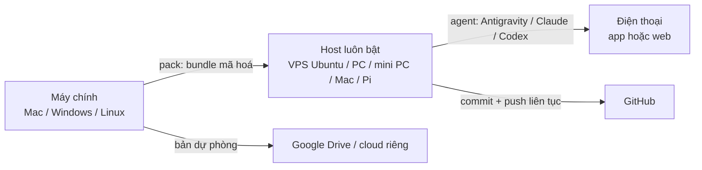

# vibecode-anywhere

**Đi đâu cũng code được, chỉ cần điện thoại.** Một máy luôn bật (VPS, máy trạm, mini PC, Mac mini, laptop cắm sạc, Raspberry Pi; chạy **Linux, macOS hoặc Windows**) chạy agent lập trình (**Antigravity CLI**, **Claude Code**, **OpenAI Codex**). Bạn ra lệnh cho agent từ điện thoại. Bộ kit chuyển nguyên trạng thái làm việc từ máy chính sang máy đó: repo đúng branch, việc chưa commit, file `.env`, cấu hình agent. Kèm theo là bộ luật để agent tự biết giữ an toàn khi chủ nhân chỉ cầm điện thoại.

[English](README.en.md) · [**Hướng dẫn sử dụng nhanh**](docs/HDSD.md) · [Chọn & dựng host](docs/HOSTS.md) · [Hướng dẫn từng agent](docs/AGENTS-GUIDE.md) · [Cứu hộ](docs/RESCUE.md) · [Prompt cho AI](PROMPT.md) · [Thay đổi](CHANGELOG.md)

> Tác giả: **Nguyễn Việt Thành (Tsen)**, [github.com/tsennguyen](https://github.com/tsennguyen). Mình viết bộ này cho một chuyến đi 3 ngày mà vẫn phải làm việc gấp, trong tay chỉ có điện thoại. Giấy phép MIT: cứ dùng, sửa, chia sẻ, giữ lại dòng credit là được.



## Có gì trong kit
| File | Chạy ở đâu | Làm gì |
|---|---|---|
| `PROMPT.md` | AI bất kỳ | **Bắt đầu từ đây nếu lười đọc.** Dán vào agent, nó hỏi bạn vài câu rồi tự điền config |
| `config/hub.example.conf` | | Mẫu config: loại host, repo, secret mang theo, agent, stack. Chép thành `config/hub.conf` |
| `profiles/*.conf` | | `small` (≤4 GB), `medium` (~8 GB), `large` (≥16 GB): swap, giới hạn RAM, Playwright, Docker |
| `pack.sh` | máy chính | Chụp trạng thái mọi repo + file gitignored → **một file mã hoá** `~/vibecode-out/bundle.tar.gz.enc` |
| `bootstrap.sh` | host Linux / macOS, 1 lần | Cài đúng những gì config chọn (apt hoặc Homebrew), giữ máy luôn thức, bật SSH cho máy ở nhà |
| `bootstrap.ps1` | host Windows, 1 lần (hỏi UAC) | Như trên, dùng winget; chặn Windows Update tự khởi động lại; bật OpenSSH Server |
| `vibe.ps1` | Windows | Chạy mọi script từ PowerShell: `.\vibe.ps1 pack`, `sync`, `install-deps`, `remote`, `doctor`, `save-all` |
| `sync.sh` | host | Clone repo, đưa về đúng branch + commit, áp lại việc chưa commit, trả secret về chỗ cũ, sinh luật cho agent. `--clone-only` nếu không có bundle |
| `install-deps.sh` | host | Tự nhận lockfile (npm/pnpm/yarn/bun/uv/pip/Maven/Gradle/Go/Cargo) rồi cài; chạy smoke test |
| `remote.sh` | host | `login` / `start` / `status` / `autostart` remote control cho từng agent, theo từng hệ điều hành |
| `doctor.sh` | host | Kiểm sức khoẻ (agent, RAM, ổ, mạng, SSH, việc chưa push), chỉ đọc |
| `save-all.sh` | host | Commit + push mọi việc dở, không bao giờ force; nhánh chính thì tách `wip/rescue-…` |
| `templates/AGENTS.md.tpl` | | Luật cho agent, điền theo config và loại máy, gắn vào `~/.gemini/GEMINI.md`, `~/.claude/CLAUDE.md`, `~/.codex/AGENTS.md` |

## Chọn cấu hình
**Host:** chi tiết, ưu nhược và checklist máy ở nhà nằm ở [docs/HOSTS.md](docs/HOSTS.md).

| `HOST_KIND` | Hệ điều hành | Gợi ý |
|---|---|---|
| `vps` | Ubuntu 22.04 / 24.04 | Đi xa, cần chắc chắn. Tác giả dùng 6 vCPU / 8 GB / 50 GB |
| `workstation`, `minipc`, `laptop` | Linux, Windows, macOS | Máy sẵn có ở nhà; thêm Tailscale để SSH, không cần mở cổng |
| `mac` | macOS | Mac mini: tiết kiệm điện; Codex chạy chính thức qua app ChatGPT |
| `sbc` | Raspberry Pi OS 64-bit | Rẻ nhất; `PROFILE="small"` |

**RAM** (`PROFILE`): `small` ≤4 GB (chỉ sửa code, build để CI lo) · `medium` ~8 GB · `large` ≥16 GB · `auto` để kit tự chọn.

**Máy chính** (nơi đóng gói): macOS, Linux, Windows (cần [Git for Windows](https://git-scm.com/download/win)).

**Agent.** Chọn một agent chính, nên có thêm một agent dự phòng:

| | Antigravity | Claude Code | Codex |
|---|---|---|---|
| Trên điện thoại | antigravity.google.com | app Claude → Code | app ChatGPT → Codex |
| Tài khoản | Google | gói Pro/Max/Team/Enterprise (API key **không** dùng được remote) | ChatGPT |
| Host Linux | service, tự lên sau reboot | tmux (+ `autostart`) | qua app ChatGPT ở máy khác, hoặc SSH + tmux |
| Host macOS / Windows | service; cần tự đăng nhập | tmux / cửa sổ nền (+ `autostart`) | **app ChatGPT desktop: chính thức** |

Chi tiết và nguồn: [docs/AGENTS-GUIDE.md](docs/AGENTS-GUIDE.md).

---

## Cách dùng
### 1. Trên máy chính: cấu hình + đóng gói (~10 phút)
```bash
git clone https://github.com/tsennguyen/vibecode-anywhere && cd vibecode-anywhere
cp config/hub.example.conf config/hub.conf     # rồi sửa, HOẶC dán PROMPT.md vào agent để nó làm giúp
./pack.sh                                      # Windows: .\vibe.ps1 pack
```
- Kết quả: thư mục `~/vibecode-out/` gồm `bundle.tar.gz.enc` (mã hoá) và `hub.conf` (không có secret).
- **Mật khẩu giải mã** nằm ở `~/.vibecode-pass`. Lưu vào trình quản lý mật khẩu trên điện thoại, **không** để chung với bundle.
- Tải `vibecode-out` lên Drive riêng làm bản dự phòng.
- Không có gì cần mang theo ngoài code trên GitHub? Bỏ qua bước này, lên host dùng `sync --clone-only`.

### 2. Dựng host (~40 phút)
Chép bundle sang host (ngồi tại host thì chép bằng USB hay Drive cũng được):
```bash
ssh-keygen -t ed25519 -f ~/.ssh/vibecode && ssh-copy-id -i ~/.ssh/vibecode.pub -p PORT USER@HOST
scp -i ~/.ssh/vibecode -P PORT -r ~/vibecode-out USER@HOST:~/
```
Windows chưa có `ssh-copy-id`: dùng PowerShell `type $env:USERPROFILE\.ssh\vibecode.pub | ssh -p PORT USER@HOST "mkdir -p ~/.ssh && cat >> ~/.ssh/authorized_keys"`; `scp` có sẵn trong Windows 10/11.

**Host Linux / macOS:**
```bash
git clone https://github.com/tsennguyen/vibecode-anywhere ~/vibecode-anywhere && cd ~/vibecode-anywhere
./bootstrap.sh                 # tự tìm config ở ~/vibecode-out/hub.conf
# mở terminal / phiên SSH mới, rồi:
gh auth login --web --git-protocol https && gh auth setup-git
./sync.sh && ./install-deps.sh
./remote.sh login && ./remote.sh start && ./doctor.sh
```
**Host Windows:** dùng PowerShell **thường** (không chọn Run as administrator), đăng nhập bằng đúng tài khoản sẽ chạy agent:
```powershell
winget install --id Git.Git -e          # xong thì mở cửa sổ PowerShell mới
git clone https://github.com/tsennguyen/vibecode-anywhere $HOME\vibecode-anywhere; cd $HOME\vibecode-anywhere
powershell -ExecutionPolicy Bypass -File .\bootstrap.ps1   # sẽ hỏi quyền Admin (UAC) một lần cho phần hệ thống
```
Sau đó mở PowerShell mới:
```powershell
gh auth login --web --git-protocol https; gh auth setup-git
.\vibe.ps1 sync; .\vibe.ps1 install-deps
.\vibe.ps1 remote login; .\vibe.ps1 remote start; .\vibe.ps1 doctor
```
Máy ở nhà (máy trạm, mini PC, Mac, laptop): làm thêm [checklist ở HOSTS.md](docs/HOSTS.md#4-danh-sách-kiểm-tra-cho-máy-ở-nhà-máy-trạm-mini-pc-laptop-mac-pi): BIOS tự bật khi có điện, tự đăng nhập, `remote autostart claude`, Tailscale. Xong thì rút điện thử một lần.

### 3. Trên điện thoại
- Mở app hoặc trang của agent (bảng ở trên), đăng nhập cùng tài khoản, chọn máy `HOST_NAME`, **Add to Home Screen**.
- Antigravity: **chọn project** mỗi khi tạo hội thoại mới.
- Cài **Termius** (hoặc Blink / JuiceSSH), thêm host (qua Tailscale nếu là máy ở nhà), thử SSH một lần. Lưu [docs/RESCUE.md](docs/RESCUE.md) để đọc offline.
- Dán **Prompt 2** trong [PROMPT.md](PROMPT.md) để thử đọc, ghi, push.

### 4. Trong chuyến đi
- Agent đã được dặn: **code xong hay test xong là commit + push**, không đụng nhánh chính, không reboot, không đổi cài đặt điện hay mạng, không in secret, mỗi lúc chỉ chạy một việc nặng. Máy dùng chung (`HOST_SHARED=1`) thì agent không đụng vào app hay file của người khác.
- Xem giao diện: link **preview deploy** (Vercel/Netlify/Cloudflare) của branch vừa push, hoặc ảnh chụp Playwright.
- Có sự cố: SSH vào, chạy `doctor.sh` (Windows: `.\vibe.ps1 doctor`), làm theo [RESCUE](docs/RESCUE.md).

### 5. Về nhà
Trên host chạy `save-all.sh`. Ở máy chính, `git fetch` rồi checkout các branch đã push. Muốn mang cả việc chưa commit về: chạy `pack.sh` trên host rồi chép bundle về.

## Tuỳ biến
- **Luật riêng cho agent:** viết vào `config/rules.extra.md`, lần `sync.sh` sau sẽ gắn vào. Muốn sửa luật chung thì sửa `templates/AGENTS.md.tpl`.
- **Đường dẫn tuyệt đối giống máy chính** (host Linux/macOS): đặt `MIRROR_PATH="/Users/ban/code"`.
- **Repo public:** liệt kê trong `PUBLIC_REPOS`. `.git/info/exclude` và git hook cục bộ được mang theo trong bundle.
- **Cài đặt riêng một repo:** `DEP_COMMANDS=("my-app|pnpm install && pnpm exec lefthook install")`.
- **Thêm profile:** chép `profiles/medium.conf` thành tên mới, rồi đặt `PROFILE="ten-moi"`.
- **Xem config đã nạp:** `./scripts/print-config.sh` (Windows: `.\vibe.ps1 config`).

## Bảo mật
- `config/hub.conf` không chứa secret và bị gitignore. Secret chỉ nằm trong bundle mã hoá (AES-256-CBC, PBKDF2 200.000 vòng, SHA-256; LibreSSL và OpenSSL 3 đọc được của nhau).
- `pack.sh` **luôn bỏ qua** file token đăng nhập (`auth.json`, `.credentials.json`, `oauth*`, `*token*`, khoá SSH). Lên host thì đăng nhập lại.
- `save-all.sh` **không bao giờ commit** file mới trông giống secret (`.env*`, key, credentials…) hay nằm trong `EXTRAS`; với `PUBLIC_REPOS` thì cũng không commit file AI (`AGENTS.md`, `CLAUDE.md`, `.claude/`…). `sync.sh` sao lưu mọi file sắp bị ghi đè vào `~/.vibecode-backup/`.
- Ai có link phiên remote control là điều khiển được phiên đó. Bật xác thực hai lớp cho tài khoản Google / Claude / ChatGPT.
- Máy ở nhà: SSH bằng key, đi qua Tailscale, **không mở cổng** trên modem. Tự đăng nhập đồng nghĩa ai cầm được máy là dùng được máy, nên để máy ở nơi an toàn.

## Đóng góp
Issue / PR đều hoan nghênh: thêm distro, agent, profile, bản dịch. Giữ `pack.sh` và `scripts/lib.sh` chạy được trên bash 3.2 (macOS) và Git Bash (Windows). File `.ps1` lưu dạng UTF-8 có BOM.

## Credit
Ý tưởng, thiết kế và bản đầu tiên: **Nguyễn Việt Thành (Tsen)**, 2026. Phát hành theo [MIT License](LICENSE).
