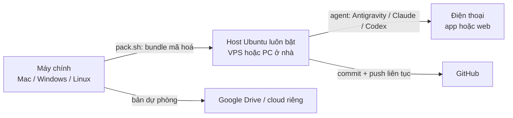

# vibecode-anywhere

**Đi đâu cũng code được, chỉ cần điện thoại.** Một máy Ubuntu luôn bật (VPS thuê hoặc PC ở nhà) chạy agent lập trình (**Antigravity CLI**, **Claude Code**, **OpenAI Codex**). Bạn ra lệnh cho agent từ điện thoại. Bộ kit này chuyển nguyên trạng thái làm việc từ máy chính sang máy đó: repo đúng branch, việc chưa commit, file `.env`, cấu hình agent. Kèm theo là bộ luật để agent tự biết giữ an toàn khi chủ nhân chỉ cầm điện thoại.

[English](README.en.md) · [**Hướng dẫn sử dụng nhanh**](docs/HDSD.md) · [Hướng dẫn từng agent](docs/AGENTS-GUIDE.md) · [Cứu hộ](docs/RESCUE.md) · [Prompt cho AI](PROMPT.md)

> Tác giả: **Nguyễn Việt Thành (Tsen)**, [github.com/tsennguyen](https://github.com/tsennguyen). Mình viết bộ này cho một chuyến đi 3 ngày mà vẫn phải làm việc gấp, trong tay chỉ có điện thoại. Giấy phép MIT: cứ dùng, sửa, chia sẻ, giữ lại dòng credit là được.



## Có gì trong kit
| File | Chạy ở đâu | Làm gì |
|---|---|---|
| `PROMPT.md` | AI bất kỳ | **Bắt đầu từ đây nếu lười đọc.** Dán vào agent, nó hỏi bạn vài câu rồi tự điền config |
| `config/hub.example.conf` | | Mẫu config: repo, secret mang theo, agent, stack, cấu hình máy. Chép thành `config/hub.conf` |
| `profiles/*.conf` | | `small` (≤4 GB), `medium` (~8 GB), `large` (≥16 GB): swap, giới hạn RAM, Playwright, Docker |
| `pack.sh` / `pack.ps1` | máy chính (Mac, Linux / Windows) | Chụp trạng thái mọi repo + file gitignored → **một file mã hoá** `~/vibecode-out/bundle.tar.gz.enc` |
| `bootstrap.sh` | host, 1 lần | Cài đúng những gì config chọn: swap, Node/pnpm/uv/Java/Docker/Go/Rust, gh/vercel/supabase/tailscale, agent; giữ máy luôn thức |
| `sync.sh` | host | Clone repo, đưa về đúng branch + commit, áp lại việc chưa commit, trả secret về chỗ cũ, sinh luật cho agent. Chạy lại nhiều lần vẫn an toàn. `--clone-only` nếu không có bundle |
| `install-deps.sh` | host | Tự nhận lockfile (npm/pnpm/yarn/bun/uv/pip/Maven/Gradle/Go/Cargo) rồi cài; chạy smoke test |
| `remote.sh` | host | `login` / `start` / `status` remote control cho từng agent |
| `doctor.sh` | host | Kiểm sức khoẻ (agent, RAM, ổ, mạng, việc chưa push), chỉ đọc |
| `save-all.sh` | host | Commit + push mọi việc dở, không bao giờ force; nhánh chính thì tách `wip/rescue-…` |
| `templates/AGENTS.md.tpl` | | Luật cho agent, được điền từ config rồi gắn vào `~/.gemini/GEMINI.md`, `~/.claude/CLAUDE.md`, `~/.codex/AGENTS.md` |
| `docs/RESCUE.md` | điện thoại | Bảng lệnh cứu hộ theo triệu chứng (khớp số mục mà `doctor.sh` báo) |

## Chọn cấu hình
**Host (máy chạy agent).** Script hỗ trợ Ubuntu 22.04+ và Debian 12+, amd64 hoặc arm64.

| Nhu cầu | Gợi ý máy | `PROFILE` | Ghi chú |
|---|---|---|---|
| Chỉ sửa code, chạy test nhẹ, build nặng để CI lo | VPS 2 vCPU / 4 GB | `small` | Rẻ nhất; tắt Playwright; mỗi lúc một container |
| Web full-stack, Docker, e2e | VPS 4–6 vCPU / 8 GB | `medium` | Cấu hình của tác giả (6 vCPU / 8 GB / 50 GB). Mỗi lúc một việc nặng |
| Monorepo lớn, nhiều dịch vụ | PC ở nhà hoặc VPS ≥16 GB | `large` | PC sau router: thêm `tailscale` để SSH, không cần mở cổng |
| Chỉ có PC Windows luôn bật | WSL2 + Ubuntu | tuỳ RAM | Thử nghiệm, xem [AGENTS-GUIDE](docs/AGENTS-GUIDE.md#windows--wsl2-as-the-host-experimental) |

**Máy chính (nơi đóng gói):** macOS, Linux, hoặc Windows (cần [Git for Windows](https://git-scm.com/download/win), chạy `pack.ps1` hoặc `pack.sh` trong Git Bash).

**Agent.** Chọn một agent chính, nên có thêm một agent dự phòng:

| | Antigravity | Claude Code | Codex |
|---|---|---|---|
| Trên điện thoại | antigravity.google.com | app Claude → Code | app ChatGPT → Codex |
| Tài khoản | Google | gói Pro/Max/Team/Enterprise (API key **không** dùng được remote) | ChatGPT |
| Chạy nền trên host | service chính thức, tự lên lại sau reboot | trong tmux (`remote.sh start claude`) | cần app ChatGPT desktop (Mac/Win) mở host qua SSH; không có thì SSH + tmux |

Chi tiết và nguồn: [docs/AGENTS-GUIDE.md](docs/AGENTS-GUIDE.md).

---

## Cách dùng
### 1. Trên máy chính: cấu hình + đóng gói (~10 phút)
```bash
git clone https://github.com/tsennguyen/vibecode-anywhere && cd vibecode-anywhere
cp config/hub.example.conf config/hub.conf     # rồi sửa, HOẶC dán PROMPT.md vào agent để nó làm giúp
./pack.sh                                      # Windows: powershell -ExecutionPolicy Bypass -File .\pack.ps1
```
- Kết quả: thư mục `~/vibecode-out/` gồm `bundle.tar.gz.enc` (mã hoá) và `hub.conf` (không có secret).
- **Mật khẩu giải mã** nằm ở `~/.vibecode-pass`. Lưu vào trình quản lý mật khẩu trên điện thoại. **Không** để chung với bundle.
- Tải `vibecode-out` lên Google Drive / OneDrive riêng làm bản dự phòng: host mất sạch vẫn dựng lại được.
- Không có gì cần mang theo ngoài code trên GitHub? Bỏ qua `pack.sh`, lên host dùng `./sync.sh --clone-only`.

### 2. Dựng host (~40 phút)
```bash
# trên máy chính: gắn SSH key (gõ mật khẩu host đúng một lần)
ssh-keygen -t ed25519 -f ~/.ssh/vibecode && ssh-copy-id -i ~/.ssh/vibecode.pub -p PORT USER@HOST
scp -i ~/.ssh/vibecode -P PORT -r ~/vibecode-out USER@HOST:~/
```
Windows chưa có `ssh-copy-id`: dùng PowerShell `type $env:USERPROFILE\.ssh\vibecode.pub | ssh -p PORT USER@HOST "mkdir -p ~/.ssh && cat >> ~/.ssh/authorized_keys"`; `scp` có sẵn trong Windows 10/11.
```bash
# trên host
sudo apt-get update && sudo apt-get install -y git
git clone https://github.com/tsennguyen/vibecode-anywhere ~/vibecode-anywhere && cd ~/vibecode-anywhere
./bootstrap.sh                 # tự tìm config ở ~/vibecode-out/hub.conf
exit                           # mở phiên SSH mới (để nhận PATH, quyền docker)
cd ~/vibecode-anywhere
gh auth login --web --git-protocol https && gh auth setup-git
./sync.sh                      # hỏi mật khẩu giải mã một lần
./install-deps.sh
./remote.sh login              # mỗi agent in một link + mã → mở trên điện thoại
./remote.sh start
./doctor.sh
```

### 3. Trên điện thoại
- Mở app / trang của agent (bảng ở trên), đăng nhập cùng tài khoản, chọn máy `HOST_NAME`, **Add to Home Screen**.
- Antigravity: **chọn project** mỗi khi tạo hội thoại mới.
- Cài **Termius** (hoặc Blink / JuiceSSH), thêm host, thử SSH một lần. Lưu [docs/RESCUE.md](docs/RESCUE.md) để đọc offline.
- Dán **Prompt 2** trong [PROMPT.md](PROMPT.md) để thử đọc, ghi, push.

### 4. Trong chuyến đi
- Agent đã được dặn: **code xong hay test xong là commit + push**, không đụng nhánh chính, không reboot, không in secret, mỗi lúc chỉ chạy một việc nặng.
- Xem giao diện: link **preview deploy** (Vercel/Netlify/Cloudflare) của branch vừa push, hoặc ảnh chụp Playwright. Host không mở cổng web ra ngoài.
- Có sự cố: SSH vào bằng Termius, chạy `~/vibecode-anywhere/doctor.sh`, làm theo [RESCUE](docs/RESCUE.md).

### 5. Về nhà
Trên host chạy `./save-all.sh`. Ở máy chính, `git fetch` rồi checkout các branch đã push. Hai máy cùng sửa một repo thì luôn push trước khi đổi máy. Muốn mang cả việc chưa commit về: chạy `./pack.sh` trên host rồi chép bundle về.

## Tuỳ biến
- **Luật riêng cho agent:** viết vào `config/rules.extra.md` (Markdown), lần `sync.sh` sau sẽ gắn vào cuối bộ luật. Muốn sửa luật chung thì sửa `templates/AGENTS.md.tpl`.
- **Đường dẫn tuyệt đối giống máy chính:** đặt `MIRROR_PATH="/Users/ban/code"`, host tạo symlink tới `HOST_ROOT`, nên docs, skill và project của agent vẫn đúng đường dẫn.
- **Repo public:** liệt kê trong `PUBLIC_REPOS`. Agent được dặn không commit file AI hay dữ liệu cá nhân vào đó. `.git/info/exclude` và git hook cục bộ (thứ không đi theo `git clone`) được mang theo trong bundle.
- **Cài đặt riêng một repo:** `DEP_COMMANDS=("my-app|pnpm install && pnpm exec lefthook install")`.
- **Thêm profile:** chép `profiles/medium.conf` thành tên mới, rồi đặt `PROFILE="ten-moi"`.

## Bảo mật
- `config/hub.conf` không chứa secret và bị gitignore. Secret chỉ nằm trong bundle mã hoá (AES-256-CBC, PBKDF2 200.000 vòng, SHA-256; LibreSSL trên macOS và OpenSSL 3 trên Linux đọc được của nhau).
- `pack.sh` **luôn bỏ qua** file token đăng nhập (`auth.json`, `.credentials.json`, `oauth*`, `*token*`, khoá SSH), dù config có ghi. Lên host thì đăng nhập lại.
- Ai có link phiên remote control là điều khiển được phiên đó. Bật xác thực hai lớp cho tài khoản Google / Claude / ChatGPT, và bật Trusted Devices của Claude nếu có.
- Host chỉ nên SSH bằng key. PC ở nhà thì dùng Tailscale thay vì mở cổng.

## Đóng góp
Issue / PR đều hoan nghênh: thêm distro, agent mới, profile, bản dịch. Giữ script chạy được trên bash 3.2 (macOS) cho phần chạy ở máy chính (`pack.sh`, `scripts/lib.sh`).

## Credit
Ý tưởng, thiết kế và bản đầu tiên: **Nguyễn Việt Thành (Tsen)**, 2026. Phát hành theo [MIT License](LICENSE).
